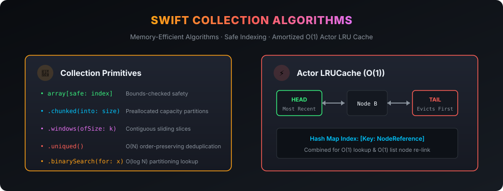

# Swift Collection Algorithms ⚡️

High-performance, memory-efficient collection algorithms and data structures for Swift: safe indexing, lazy chunking, sliding windows, ordered deduplication, and a thread-safe actor-based LRU Cache.

[](https://github.com/nilkanthdesai76/swift-collection-algorithms/actions)
[](https://swift.org)
[](https://developer.apple.com)
[](https://swift.org/package-manager/)
[](LICENSE)

<p align="center">
  
</p>

---

## 🎯 Motivation

Every production Swift codebase eventually reinvents the same utility routines: safe array subscripts to prevent crashes, dividing lists into batch chunks for network uploads, sliding windows, and caching with eviction policies.

**Swift Collection Algorithms** provides zero-dependency, rigorously tested, $O(N)$ and $O(1)$ algorithmic extensions optimized for Swift's Copy-on-Write (COW) mechanics and Swift 6 Concurrency.

---

## 📦 Features

- 🛡️ **Safe Indexing**: `array[safe: index]` safely returns optional elements without crashing.
- 📦 **Preallocated Chunking**: Divide collections into discrete slices with reserved capacity.
- 🪟 **Sliding Windows**: Contiguous moving slices for analytics, smoothing, or tokenizers.
- 🧹 **Order-Preserving Deduplication**: `.uniqued()` runs in $O(N)$ time preserving first-seen order.
- 🔍 **Binary Search & Insertion Index**: $O(\log N)$ lookup and partition insertion.
- ⚡ **Actor-Based `LRUCache`**: Thread-safe Least Recently Used cache with amortized $O(1)$ operations combining a hash map and doubly-linked list.

---

## 🚀 Usage

### 1. Safe Indexing

```swift
import CollectionAlgorithms

let items = ["Swift", "Kotlin", "Rust"]
let safeItem = items[safe: 5] // nil (does not crash!)
```

### 2. Batch Chunking & Sliding Windows

```swift
let userIds = [1, 2, 3, 4, 5, 6, 7]

// Split into batches of 3 for batch API upload
let batches = userIds.chunked(into: 3)
// [[1, 2, 3], [4, 5, 6], [7]]

// 2-element moving window
let windows = [10, 20, 30, 40].windows(ofSize: 2)
// [[10, 20], [20, 30], [30, 40]]
```

### 3. Order-Preserving Deduplication

```swift
let duplicates = [3, 1, 2, 3, 4, 1, 5]
let clean = duplicates.uniqued()
// [3, 1, 2, 4, 5]

// Deduplicate custom models by keypath
let uniqueUsers = users.uniqued(by: \.email)
```

### 4. Actor-Based `LRUCache` ($O(1)$)

```swift
let imageCache = LRUCache<URL, Data>(capacity: 100)

// Save image
await imageCache.set(imageData, forKey: imageURL)

// Retrieve (moves to most-recently-used head)
if let cached = await imageCache.get(imageURL) {
    render(cached)
}

// When count > 100, the oldest accessed image is automatically evicted!
```

---

## 🛠️ Installation via Swift Package Manager

Add the following to your `Package.swift`:

```swift
dependencies: [
    .package(url: "https://github.com/nilkanthdesai76/swift-collection-algorithms.git", from: "1.0.0")
]
```

---

## 📄 License

This project is licensed under the MIT License - see the [LICENSE](LICENSE) file for details.
